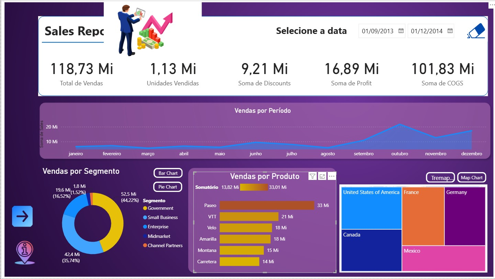
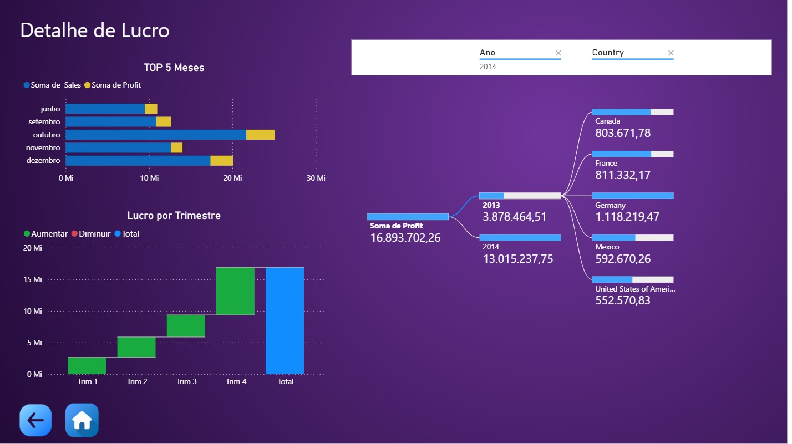

# 📊 Report Financeiro - Dashboard de Data Analytics com Power BI

> **Projeto prático de Business Intelligence, Data Analytics e Design de Dashboards (UX/UI) desenvolvido para a formação na [DIO (Digital Innovation One)](https://dio.me).**

---

## 🎯 Objetivo do Projeto
O objetivo deste projeto foi construir um **Relatório Financeiro Corporativo Interativo** completo no Power BI, transformando dados brutos de vendas e lucro em visões estratégicas para tomada de decisão através de métricas avançadas, visuais modernos de analytics e navegabilidade fluida.

---

## 🎨 Design & Experiência do Usuário (UX/UI)
* **Tema Visual (Purple Dark Theme):** Layout escuro moderno com alto contraste para reduzir a fadiga visual e destacar os indicadores.
* **Capa / Landing Page Profissional:** Página de entrada intuitiva com botão interativo para direcionar o usuário à análise.
* **Navegabilidade por Botões:** Botões customizados de navegação (`Voltar`, `Home`, `Avançar`) e alternadores de visão para transição entre as páginas.
* **Hierarquia Visual:** Cartões de KPI posicionados no topo para leitura imediata dos principais números da organização (Vendas Totais, Lucro, Descontos e Custos COGS).

---

## 📄 Estrutura das Páginas do Relatório

### 1. 🚀 Capa / Landing Page
* Apresentação visual da solução com botão interativo **"Explorar análise"** que direciona o usuário para o relatório executivo.

### 2. 📈 Sales Report (Visão Geral de Vendas)
* **KPIs no Topo:** Total de Vendas, Unidades Vendidas, Soma de Descontos, Soma de Lucro e COGS.
* **Análise Temporal:** Gráfico de Área com a evolução das vendas por mês.
* **Comportamento Comercial:** Gráfico de Rosca por Segmento, Gráfico de Barras por Produto e **Treemap** por País.

### 3. 🔍 Detalhes de Vendas
* **Análise Comparativa:** Gráfico de colunas por Semestre (comparando 2013 vs 2014) e Matriz detalhada por Trimestre.
* **Distribuição:** **Histograma** de frequência de unidades vendidas e Ranking de produtos.
* **Alternadores:** Filtros dinâmicos por período (Semestre/Mês).

### 4. 💰 Detalhe de Lucro (Analytics Avançado)
* **Árvore de Decomposição (Decomposition Tree):** Análise exploratória interativa desdobrando o Lucro por Ano e País.
* **Gráfico de Cascata (Waterfall):** Análise acumulada do Lucro por Trimestre.
* **Ranking TOP 5 Meses:** Comparativo entre Vendas e Lucro nos melhores meses do ano.

---

## 🖼️ Galeria do Dashboard

### 1. Capa / Landing Page

### 2. Relatório de Vendas (Visão Geral)

### 3. Detalhes de Vendas

### 4. Detalhe de Lucro

---

## 🛠️ Tecnologias e Recursos Utilizados
* **Microsoft Power BI Desktop**
* **Power Query Editor** (ETL e Limpeza de Dados)
* **Linguagem DAX** (Métricas e Inteligência de Tempo)
* **Visuais Avançados:** Árvore de Decomposição, Gráfico de Cascata, Histograma e Treemap.
* **Design UX/UI:** Navegação por botões, filtros dinâmicos e paleta *Purple Dark Theme*.
* **Git & GitHub** (Versionamento e Portfólio)

---

Desenvolvido com 💙 durante a Formação Power BI Analyst na **DIO**.
